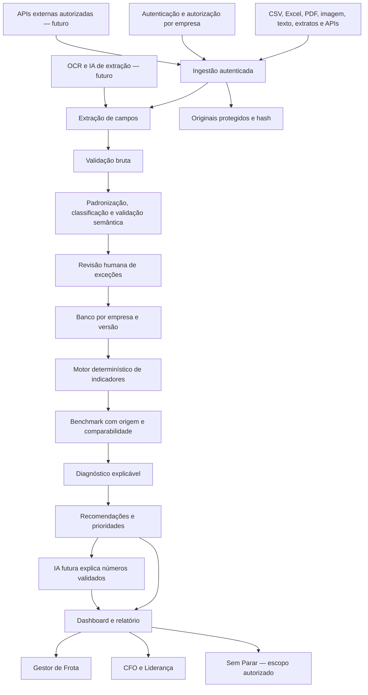

# Arquitetura — planejado e implementado

## Visão alvo

## Componentes e responsabilidades

| Componente | Bônus local | Ambiente futuro |
|---|---|---|
| Interface | Streamlit, upload, filtros, perfil visual | Portal com identidade e papéis |
| Ingestão | CSV / XLSX, limites e leitura tabular | APIs com escopos, filas e idempotência |
| Extração | Leitura direta de colunas | OCR, schema e revisão humana |
| Validação | Chaves, tipos, valores, conciliação | Quarentena, aprovação e trilha |
| Armazenamento | DataFrame em memória; nenhum banco | PostgreSQL com isolamento por empresa e storage cifrado |
| Análise | Pandas, cálculo determinístico | Serviço versionado com testes |
| Benchmark | CSV simulado local | Referências aprovadas, histórico e segmentação |
| Recomendações | Regras fixas, sem enviar leads | Catálogo revisado com governança |
| Relatório | Markdown para download | PDF auditável e indicadores de resultados |
| Autenticação | Não implementada | OIDC, MFA administrativo, sessões expiradas |
| IA | Não implementada | OCR / classificação / explicação com avaliação |

Banco relacional atende chaves e séries. Originais separados permitem reprocessamento sem sobrecarregar tabelas. Fluxos assíncronos ficam para documentos pesados; no MVP a execução síncrona é suficiente. Nenhuma credencial ou integração da Sem Parar é necessária.

## Entidades futuras e atualização

Empresa → Veículo → CustoMensal. Importação registra origem, hash, autor e versão. Benchmark registra contexto e validade. Diagnóstico aponta versões de entrada e regra. Ação registra responsável, prazo, status e métrica. Alterar um mês existente exige revisão e nova versão, mantendo histórico e evitando duplicação. Agregados compartilhados são separados da base operacional e dependem de autorização.

## Limites

Não há infraestrutura produtiva, OCR, autenticação, serviço de IA ou banco implementados. O perfil no painel é somente uma apresentação. A aplicação roda no localhost e usa dados fictícios. A arquitetura alvo não é evidência de implementação.
